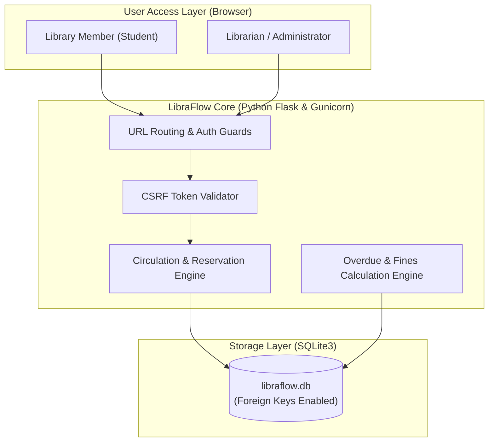

# LibraFlow — Modern Library Management System

[](https://www.python.org/)
[](https://flask.palletsprojects.com/)
[](https://www.docker.com/)
[](https://kubernetes.io/)
[](https://aws.amazon.com/)
[](#automated-testing)

A full-stack, enterprise-grade Library Management System designed for a **Bachelor of Computer Applications (BCA) Microproject**. 

LibraFlow implements complete library circulation workflows (cataloging, accession tracking, loans, returns, reservation queuing, and automated overdue fines calculation) while demonstrating all five modern infrastructure syllabus modules: **Virtualization**, **KVM Automation**, **Docker Containerization**, **Kubernetes Orchestration**, and **AWS Serverless Architecture**.

---

## Table of Contents
1. [Project Abstract](#1-project-abstract)
2. [Problem Statement](#2-problem-statement)
3. [Objectives & Scope](#3-objectives--scope)
4. [Software & Hardware Requirements](#4-software--hardware-requirements)
5. [Key Application Features](#5-key-application-features)
6. [Technology Stack](#6-technology-stack)
7. [System Architecture](#7-system-architecture)
8. [Database Design](#8-database-design)
9. [Project Directory Structure](#9-project-directory-structure)
10. [Local Installation & Run Guide (Windows)](#10-local-installation--run-guide-windows)
11. [Demo Credentials & Quick Walkthrough](#11-demo-credentials--quick-walkthrough)
12. [Automated Testing (pytest)](#12-automated-testing-pytest)
13. [Module 1: Virtualization (VirtualBox)](#13-module-1-virtualization-virtualbox)
14. [Module 2: Virtualization Tools & Automation (KVM/virsh)](#14-module-2-virtualization-tools--automation-kvmvirsh)
15. [Module 3: Docker Containerization](#15-module-3-docker-containerization)
16. [Module 4: Kubernetes Orchestration (Minikube)](#16-module-4-kubernetes-orchestration-minikube)
17. [Module 5: Serverless Architecture (AWS Lambda & API Gateway)](#17-module-5-serverless-architecture-aws-lambda--api-gateway)
18. [Screenshots Checklist](#18-screenshots-checklist)
19. [Limitations & Future Enhancements](#19-limitations--future-enhancements)
20. [Conclusion](#20-conclusion)

---

## 1. Project Abstract
Academic libraries require reliable, auditable systems to manage book inventory, prevent lost assets, ensure fair loan turnover, and prevent double-issuance of physical copies. **LibraFlow** is a web-based management platform built using Python Flask and SQLite, featuring a responsive Bootstrap 5 interface styled in dark navy, teal, and warm cream. Beyond standard CRUD operations, LibraFlow enforces physical copy-level tracking through unique accession numbers, transaction-safe loan lifecycles, and automatic overdue penalty synchronization. 

To demonstrate modern DevOps and Cloud curricula, the project provides end-to-end deployment artifacts and technical documentation for Type 2 hypervisors (VirtualBox), Type 1 KVM automation scripts, production Docker images with Gunicorn, Kubernetes manifests with rolling updates, and AWS Serverless functions with S3 event triggers.

---

## 2. Problem Statement
Traditional paper-based or basic single-table library systems suffer from critical limitations:
1. **Lack of Physical Copy Visibility**: Recording only total copy count without individual accession numbers makes it impossible to pinpoint which exact copy is checked out or on which shelf.
2. **Double Borrowing Errors**: Without transaction guards, a single physical copy can mistakenly be issued to multiple students simultaneously.
3. **Manual Overdue Calculation**: Manual ledger checks often fail to detect overdue loans or miscalculate fine totals.
4. **Environment Drift**: College software developed locally frequently fails to run on evaluation machines due to conflicting system dependencies, missing virtual environments, or disparate OS configurations.

LibraFlow solves these problems through transactional relational constraints and containerized, reproducible deployment configurations.

---

## 3. Objectives & Scope

### 3.1 Objectives
* Develop an intuitive, role-based web interface for Administrators, Librarians, and Students.
* Maintain physical inventory with unique accession numbers and shelf locations.
* Implement robust borrowing and return rules (prevent borrowing unavailable copies, reject duplicate returns).
* Automate daily overdue loan identification and fine calculation.
* Provide comprehensive, verifiable demonstration artifacts for all five virtualization, container, and cloud syllabus modules.

### 3.2 Scope
* **In Scope**: Local relational database with foreign keys, role-based authentication, CSRF protection, inventory management, circulation desk, reservation queueing, simulated fine ledgers, automated tests, Docker, Kubernetes, and AWS Lambda microservices.
* **Out of Scope**: Real online payment gateway integration (simulated desk settlement is provided as per project specification), distributed credit card processing, and external proprietary proprietary library protocols (Z39.50/SIP2).

---

## 4. Software & Hardware Requirements

### 4.1 Software Requirements
* **Operating System**: Windows 10/11, Ubuntu Linux 22.04/24.04 LTS, or macOS.
* **Programming Language**: Python 3.10+ (tested on Python 3.12 and 3.13).
* **Database Engine**: SQLite 3 (built into Python standard library).
* **Container Engine**: Docker Desktop 4.x+ / Docker Engine.
* **Kubernetes**: Minikube v1.30+ and `kubectl` v1.28+.
* **Virtualization**: Oracle VM VirtualBox 7.x (for Module 1).
* **Web Browser**: Google Chrome, Mozilla Firefox, or Microsoft Edge.

### 4.2 Minimum Hardware Requirements
* **Processor (CPU)**: 64-bit Dual-Core Intel Core i3 / AMD Ryzen 3 (Quad-Core recommended for Minikube).
* **RAM**: 8 GB RAM (minimum 4 GB for basic local Flask run; 12-16 GB optimal for running Minikube + Docker simultaneously).
* **Disk Space**: 10 GB free storage.

---

## 5. Key Application Features

* **Role-Based Access Control (RBAC)**: Distinct interfaces and permissions for Administrator, Librarian, and Student/Member.
* **Live Dashboards**: 
  * Admin: Total titles, physical copies, available copies, active loans, overdue returns, pending reservations, and unpaid fines.
  * Librarian: Circulation desk, rapid issue/return workflows, and reservation holds.
  * Student: Personal borrowing history, due date warnings, reservation queue status, and outstanding fines.
* **Copy-Level Accession Tracking**: Every book copy has its own unique accession identifier (`LIB-CC-001`), shelf location, and status (`available`, `borrowed`, `reserved`, `maintenance`).
* **Safe Borrowing & Return Logic**:
  * Prevents issuing copies that are already borrowed or in maintenance.
  * Enforces active member eligibility.
  * Rejects duplicate or invalid returns.
  * Automatically transitions copy status upon return (allocating to waiting reservations if queued).
* **Automated Overdue Fines**: Calculates overdue days and records fines automatically at \$1.00/day.
* **Reservation Queue**: Allows students to place holds on books with real-time status tracking (`pending`, `fulfilled`, `cancelled`).
* **Catalog Search & Filtering**: Instant search across titles, authors, and ISBNs, with category dropdowns and availability filters.
* **Comprehensive Audit Reports**: Category distribution breakdown and overdue loans audit list with print/PDF support.

---

## 6. Technology Stack

* **Frontend**: HTML5, CSS3, JavaScript (ES6), Bootstrap 5.3, FontAwesome 6.
* **Backend**: Python 3, Flask 3.1, Jinja2 template engine.
* **WSGI Production Server**: Gunicorn 21.2 (for Linux / Docker).
* **Database**: SQLite3 with foreign key enforcement and transactional integrity.
* **Security**: Werkzeug password hashing (salted scrypt), session management, CSRF token validation.
* **Testing**: `pytest` 9.1 with temporary in-memory/isolated SQLite databases.
* **DevOps**: Docker, Docker Compose, Kubernetes (Minikube), KVM/libvirt, AWS Lambda, Amazon API Gateway, Amazon S3.

---

## 7. System Architecture



For comprehensive architectural blueprints, including container pipelines and serverless data flows, see [docs/architecture.md](docs/architecture.md).

---

## 8. Database Design

LibraFlow utilizes an audited relational schema with 6 interconnected tables:

```
┌──────────────┐       ┌──────────────┐       ┌──────────────────┐
│    users     │       │    books     │       │   book_copies    │
├──────────────┤       ├──────────────┤       ├──────────────────┤
│ id (PK)      │       │ id (PK)      │1     *│ id (PK)          │
│ full_name    │       │ isbn (UNIQUE)├───────┤ book_id (FK)     │
│ username (UQ)│       │ title        │       │ accession_num(UQ)│
│ email (UQ)   │       │ author       │       │ status           │
│ password_hash│       │ publisher    │       │ location         │
│ role         │       │ category     │       │ created_at       │
│ status       │       │ pub_year     │       └────────┬─────────┘
└──────┬───────┘       └──────┬───────┘                │1
       │1                     │1                       │
       │                      │                        │*
       │*                     │*              ┌────────┴─────────┐
┌──────┴───────┐       ┌──────┴───────┐       │      loans       │
│ reservations │       │ reservations │       ├──────────────────┤
├──────────────┤       ├──────────────┤       │ id (PK)          │
│ id (PK)      │       │ book_id (FK) │       │ book_copy_id(FK) │
│ member_id(FK)│       │ member_id(FK)│       │ member_id (FK)   │
│ status       │       │ status       │       │ issue_date       │
└──────────────┘       └──────────────┘       │ due_date         │
                                              │ return_date      │
                                              │ loan_status      │
                                              └────────┬─────────┘
                                                       │1
                                                       │*
                                              ┌────────┴─────────┐
                                              │      fines       │
                                              ├──────────────────┤
                                              │ id (PK)          │
                                              │ loan_id (FK)     │
                                              │ amount           │
                                              │ reason           │
                                              │ payment_status   │
                                              └──────────────────┘
```

---

## 9. Project Directory Structure

```
LibraFlow/
├── app.py                      # Core Flask application & routing
├── config.py                   # Environment configuration classes
├── requirements.txt            # Python dependencies (Flask, Gunicorn, pytest)
├── pytest.ini                  # Pytest path and runner configuration
├── Dockerfile                  # Production multi-stage Docker build
├── docker-compose.yml          # Container orchestration with named volume
├── .dockerignore               # Docker build exclusions
├── .gitignore                  # Git version control exclusions
├── .env.example                # Sample environment variables
├── README.md                   # Master project report & documentation
├── templates/                  # Jinja2 HTML5 templates
│   ├── base.html               # Master layout with navbar, alerts, footer
│   ├── index.html              # Landing page with search & metric counters
│   ├── login.html              # Sign-in page with 1-click demo credential pills
│   ├── register.html           # Member registration
│   ├── admin_dashboard.html    # Admin KPI control center
│   ├── librarian_dashboard.html# Circulation desk & pending returns
│   ├── member_dashboard.html   # Student personal loans & reservations
│   ├── member_loans.html       # Student full borrowing history
│   ├── books.html              # Catalog grid with live category/status filters
│   ├── book_detail.html        # Book metadata, copy accessions & reserve button
│   ├── book_form.html          # Add / Edit book records
│   ├── members.html            # User management & account activation
│   ├── loans.html              # Loan ledger & book issue modal
│   ├── reservations.html       # Book reservation hold queue
│   ├── fines.html              # Overdue fines ledger & settlement actions
│   ├── reports.html            # Inventory by category & overdue audit
│   └── error.html              # Custom 400, 403, 404, 500 error pages
├── static/                     # Static styling & client interactivity
│   ├── css/style.css           # Custom navy, teal & cream design palette
│   └── js/main.js              # Table filters, alert auto-dismiss, demo helpers
├── database/                   # Relational database logic & seeding
│   ├── schema.sql              # DDL schema with tables, FKs & indexes
│   ├── db.py                   # Connection management & overdue sync helpers
│   ├── init_db.py              # CLI database schema initializer
│   ├── seed_data.py            # Rich demo seed script (Admin, Librarian, Books)
│   └── libraflow.db            # Local SQLite database
├── scripts/                    # Module 2 Virtualization Automation Shell Scripts
│   ├── check_virtualization.sh # Diagnostic script for CPU flags (vmx/svm)
│   ├── setup_kvm.sh            # Automated KVM/QEMU/libvirt setup
│   └── manage_vm.sh            # virsh automation (start/stop/status/list)
├── kubernetes/                 # Module 4 Kubernetes Manifests
│   ├── namespace.yaml          # Isolated 'libraflow' namespace
│   ├── configmap.yaml          # Non-sensitive runtime settings
│   ├── secret.yaml.example     # Base64 secret template
│   ├── deployment.yaml         # Pod deployment with liveness/readiness probes
│   ├── service.yaml            # NodePort 30080 service exposure
│   └── README.md               # Quickstart Kubernetes guide
├── serverless/                 # Module 5 AWS Serverless Architecture
│   ├── book_availability_function.py # Function A: API Gateway GET endpoint
│   ├── lambda_function.py      # Function B: API Gateway POST reservation
│   ├── s3_event_function.py    # Function C: S3 ObjectCreated event processor
│   ├── template.yaml           # AWS SAM Infrastructure as Code template
│   ├── test_local.py           # Standalone local test runner (0 cloud cost)
│   └── README.md               # Serverless deployment notes
├── tests/                      # Automated Test Suite (pytest)
│   ├── conftest.py             # Temporary test DB fixture & auth helpers
│   ├── test_auth.py            # Authentication, registration & role security
│   ├── test_books.py           # Catalog CRUD, ISBN & accession uniqueness
│   ├── test_loans_returns.py   # Circulation, returns & overdue calculation
│   ├── test_reservations_fines.py # Holds, privacy & fine payments
│   └── test_api_health.py      # /health endpoint & CSRF token rejection
├── screenshots/                # Practical Record Evidence
│   └── README.md               # Screenshot list with filenames & descriptions
└── docs/                       # Detailed Syllabus Module Guides
    ├── architecture.md         # Architecture diagrams & comparison matrix
    ├── module1-virtualization.md # VirtualBox Ubuntu setup & snapshots
    ├── module2-automation.md   # KVM, QEMU, libvirt & shell scripting
    ├── module3-docker.md       # Docker build, volumes & Docker Hub guide
    ├── module4-kubernetes.md   # Minikube, scaling, rolling updates & rollback
    ├── module5-serverless.md   # AWS Lambda, API Gateway & SAM deployment
    └── viva_questions.md       # 25 Viva Voce Q&A across all modules
```

---

## 10. Local Installation & Run Guide (Windows)

### Step 1: Open PowerShell in the Project Directory
Ensure you are in the project root:
```powershell
cd "c:\Users\ASUS\OneDrive\Desktop\Library management system"
```

### Step 2: Create and Activate Virtual Environment
```powershell
# Create virtual environment
python -m venv venv

# Activate virtual environment
.\venv\Scripts\Activate.ps1
```
*(If PowerShell blocks execution of scripts, run `Set-ExecutionPolicy -ExecutionPolicy RemoteSigned -Scope CurrentUser` once).*

### Step 3: Install Required Dependencies
```powershell
pip install -r requirements.txt
```

### Step 4: Initialize and Seed the Database
```powershell
python database/seed_data.py
```
*Output confirms creation of demo users, books, physical copies, and active/overdue loans.*

### Step 5: Start the Development Server
```powershell
python app.py
```
Open your web browser and navigate to:
```
http://localhost:5000
```

---

## 11. Demo Credentials & Quick Walkthrough

For seamless demonstration during practical exams, the sign-in page (`/login`) includes **1-click credential pre-fill buttons**:

| Role | Username | Password | Key Permissions |
| :--- | :--- | :--- | :--- |
| **Administrator** | `admin` | `Admin@123` | Full system control, manage users, delete books, audit reports, system settings. |
| **Librarian** | `librarian1` | `Librarian@123` | Circulation desk, issue/return copies, manage reservations, record fine payments. |
| **Student 1** | `student1` | `Student@123` | Search books, reserve books, view personal loans, check personal fines. |
| **Student 2** | `student2` | `Student@123` | Account with an active overdue book loan demonstrating late fine warnings. |
| **Student 3** | `student3` | `Student@123` | Account with an active loan on "Kubernetes: Up and Running". |

---

## 12. Automated Testing (pytest)

The test suite tests the system across all business rules using a temporary, isolated SQLite database (leaving development data untouched):

```powershell
.\venv\Scripts\pytest -v
```

### Test Results
```
============================= test session starts =============================
platform win32 -- Python 3.13.14, pytest-9.1.1
rootdir: C:\Users\ASUS\OneDrive\Desktop\Library management system
collected 23 items

tests/test_api_health.py::test_health_endpoint PASSED                    [  4%]
tests/test_api_health.py::test_csrf_protection_blocks_invalid_post PASSED [  8%]
tests/test_api_health.py::test_404_error_page PASSED                     [ 13%]
tests/test_auth.py::test_homepage_loads PASSED                           [ 17%]
tests/test_auth.py::test_registration_works PASSED                       [ 21%]
tests/test_auth.py::test_registration_rejects_duplicate_user PASSED      [ 26%]
tests/test_auth.py::test_login_and_logout_works PASSED                   [ 30%]
tests/test_auth.py::test_invalid_password_rejected PASSED                [ 34%]
tests/test_auth.py::test_unauthorized_access_blocked PASSED              [ 39%]
tests/test_books.py::test_books_catalog_and_filter PASSED                [ 43%]
tests/test_books.py::test_admin_can_create_and_edit_book PASSED          [ 47%]
tests/test_books.py::test_duplicate_isbn_rejected PASSED                 [ 52%]
tests/test_books.py::test_physical_copies_have_unique_accession PASSED   [ 56%]
tests/test_books.py::test_cannot_delete_book_with_active_loans PASSED    [ 60%]
tests/test_loans_returns.py::test_borrow_available_book PASSED           [ 65%]
tests/test_loans_returns.py::test_cannot_borrow_unavailable_copy PASSED  [ 69%]
tests/test_loans_returns.py::test_return_book_updates_availability PASSED [ 73%]
tests/test_loans_returns.py::test_invalid_return_rejected PASSED         [ 78%]
tests/test_loans_returns.py::test_overdue_status_and_fine_calculation PASSED [ 82%]
tests/test_reservations_fines.py::test_member_can_reserve_eligible_book PASSED [ 86%]
tests/test_reservations_fines.py::test_member_cannot_access_other_member_private_loans PASSED [ 91%]
tests/test_reservations_fines.py::test_member_can_cancel_own_reservation PASSED [ 95%]
tests/test_reservations_fines.py::test_pay_or_waive_fine PASSED          [100%]

============================= 23 passed in 2.77s ==============================
```

---

## 13. Module 1: Virtualization (VirtualBox)

Demonstrates Type 2 hypervisor deployment on an Ubuntu Linux guest virtual machine:
* Configured VM: 4096 MB RAM, 2 vCPUs, 25 GB VDI disk.
* Port forwarding rule: Host Port `5000` -> Guest Port `5000`.
* Disaster recovery demonstrated via VirtualBox **Snapshots** (`LibraFlow-Working-Baseline`).
* Complete step-by-step instructions available in [docs/module1-virtualization.md](docs/module1-virtualization.md).

---

## 14. Module 2: Virtualization Tools & Automation (KVM/virsh)

Demonstrates Linux enterprise kernel virtualization and shell automation:
* `scripts/check_virtualization.sh`: Verifies CPU flags (`vmx`/`svm`) and `/dev/kvm` permissions.
* `scripts/setup_kvm.sh`: Automated installer for `qemu-kvm`, `libvirtd`, and `virt-manager`.
* `scripts/manage_vm.sh`: Scripted lifecycle manager for `virsh` (start, stop, reboot, status, list, console).
* Complete documentation available in [docs/module2-automation.md](docs/module2-automation.md).

---

## 15. Module 3: Docker Containerization

Packages LibraFlow into an immutable, secure Linux container running Gunicorn:

```powershell
# Build image
docker build -t libraflow-app:1.0.0 .

# Run container with volume persistence
docker run -d --name libraflow-container -p 5000:5000 -v libraflow-db-data:/app/data libraflow-app:1.0.0

# Verify health status
Invoke-RestMethod -Uri http://localhost:5000/health

# Or launch with Docker Compose
docker compose up -d
```
* Complete commands and Docker Hub publishing steps available in [docs/module3-docker.md](docs/module3-docker.md).

---

## 16. Module 4: Kubernetes Orchestration (Minikube)

Orchestrates LibraFlow on a local Minikube cluster:

```powershell
# 1. Start Minikube & load image
minikube start --driver=docker
minikube image load libraflow-app:1.0.0

# 2. Apply manifests
kubectl apply -f kubernetes/namespace.yaml
Copy-Item kubernetes/secret.yaml.example kubernetes/secret.yaml
kubectl apply -f kubernetes/secret.yaml
kubectl apply -f kubernetes/configmap.yaml
kubectl apply -f kubernetes/deployment.yaml
kubectl apply -f kubernetes/service.yaml

# 3. Access service
minikube service libraflow-service -n libraflow
```
* Demonstrations for **Horizontal Scaling** (`kubectl scale`), **Rolling Updates** (`kubectl set image`), and **Zero-Downtime Rollback** (`kubectl rollout undo`) are documented in [docs/module4-kubernetes.md](docs/module4-kubernetes.md).

---

## 17. Module 5: Serverless Architecture (AWS Lambda & API Gateway)

Implements 3 serverless microservices:
* **Function A**: Public Book Availability API (GET `/books/availability`).
* **Function B**: Book Reservation Processing API (POST `/books/reserve`).
* **Function C**: S3 Catalog Document Ingestion Event Processor (`s3:ObjectCreated:*`).

### Run Local Verification (Zero Cloud Cost)
```powershell
python serverless/test_local.py
```
* Output confirms 100% test pass on all 3 functions.
* Complete AWS SAM deployment, IAM least-privilege policies, and free-tier cost notes are detailed in [docs/module5-serverless.md](docs/module5-serverless.md).

---

## 18. Screenshots Checklist

Refer to [screenshots/README.md](screenshots/README.md) for the complete list of 27 screenshots required for the lab file, including homepage metrics, circulation desk, pytest passes, Docker health status, Minikube pods, and serverless runs.

---

## 19. Limitations & Future Enhancements

### Limitations
1. **SQLite Concurrency**: SQLite is an embedded single-file database. While ideal for single-container and single-pod deployments, multi-replica Kubernetes horizontal scaling requires a shared database like PostgreSQL.
2. **Simulated Payments**: Fines are recorded and settled internally at the circulation desk without a real financial merchant gateway (in compliance with academic project guidelines).

### Future Enhancements
* Integration with Amazon RDS PostgreSQL for high-concurrency Kubernetes clusters.
* RFID / Barcode scanner hardware integration for rapid desk checkouts.
* Email / SMS reminders for due dates using Amazon SNS or SendGrid.

---

## 20. Conclusion

**LibraFlow — Library Management System** successfully delivers a complete, production-ready educational platform. It bridges application development and modern DevOps practices by packaging real business logic into a maintainable Python Flask application, accompanied by practical implementations of VirtualBox virtualization, KVM shell scripting, Docker containerization, Kubernetes cluster orchestration, and AWS serverless event handling.
