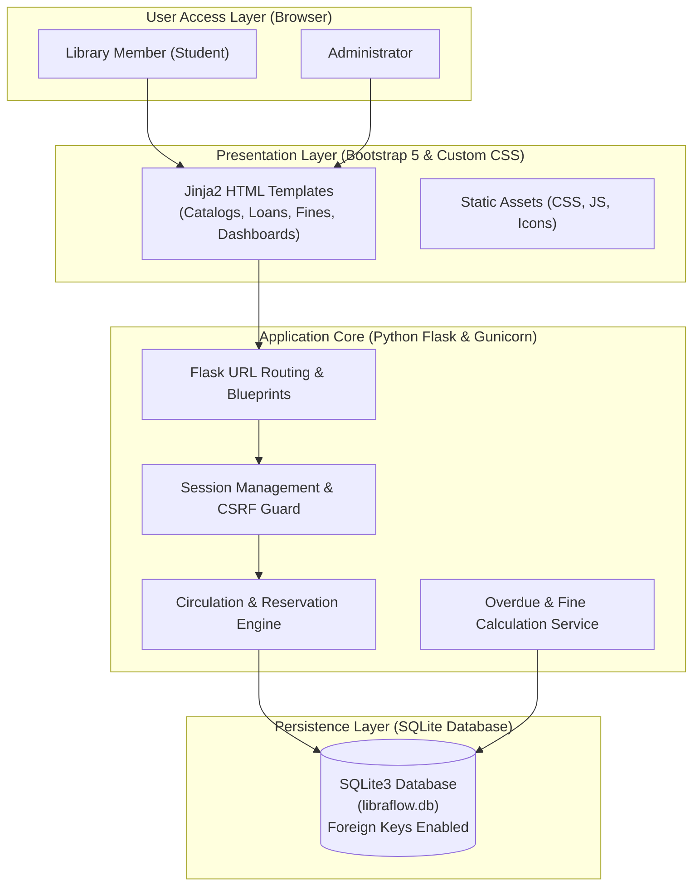
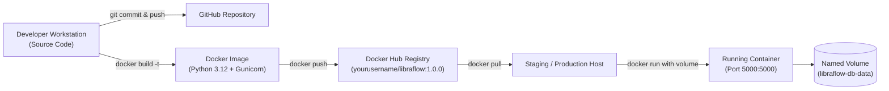
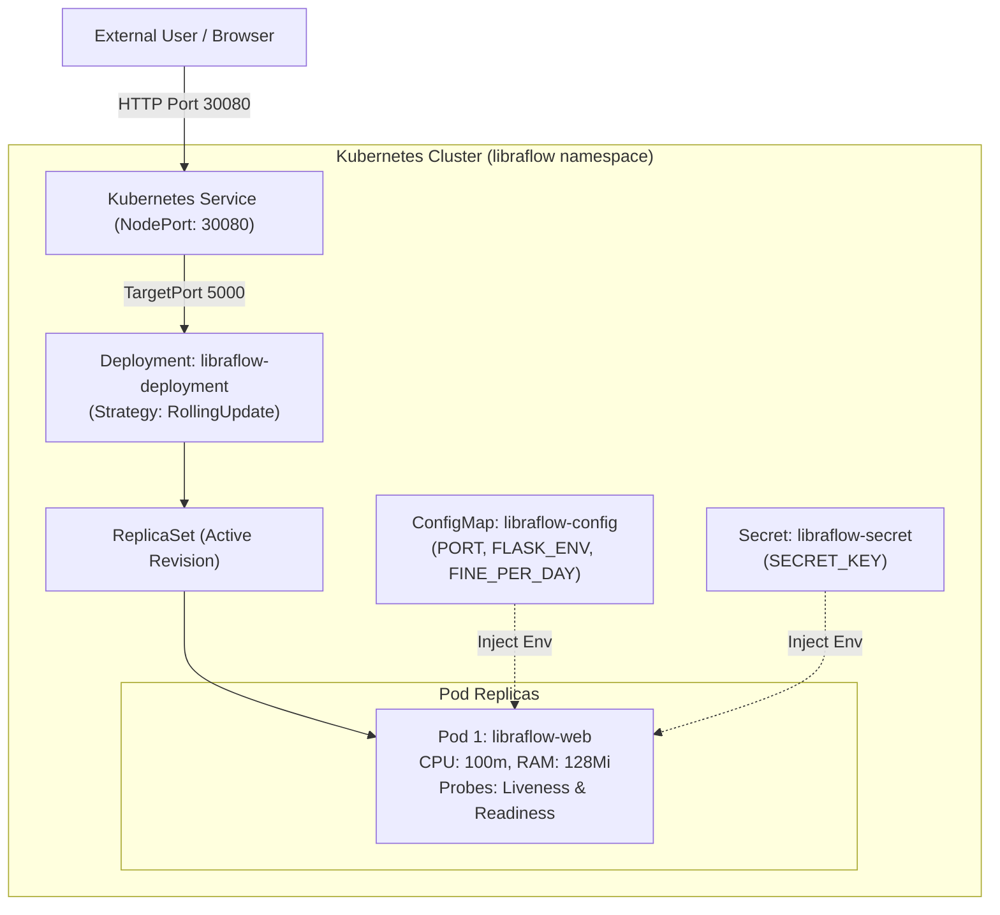
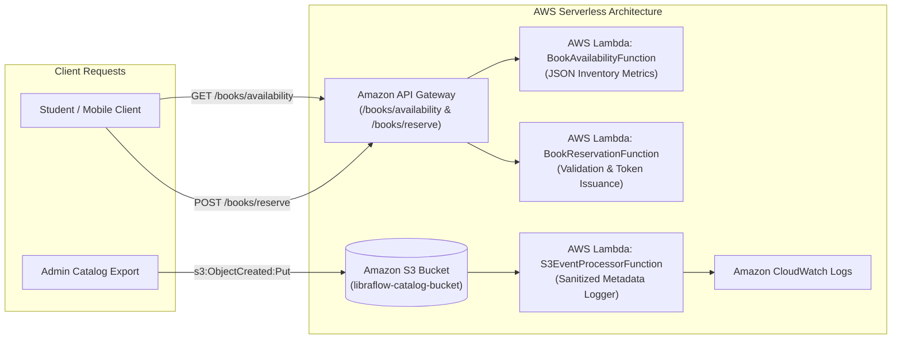

# LibraFlow — System Architecture & Deployment Blueprint

This document details the architectural design of **LibraFlow — Library Management System**, spanning core application layers, containerized deployment pipelines, Kubernetes cluster orchestration, and AWS serverless extensions.

> [!NOTE]
> **Complementary Deployment Stages**:
> Virtualization, Docker, Kubernetes, and Serverless represent progressive deployment tiers of the modern software lifecycle rather than a mandate to execute every component simultaneously. Each module demonstrates practical mastery of specific cloud-native infrastructure competencies.

---

## 1. Core Application Architecture

The monolithic web application is constructed around a clean Model-View-Controller (MVC) paradigm:

---

## 2. Containerization & Registry Pipeline (Docker & Docker Hub)

---

## 3. Kubernetes Orchestration Architecture (Minikube / Production Cluster)

---

## 4. Serverless Event-Driven Microservices (AWS Lambda & API Gateway)

---

## 5. Architectural Comparison Matrix

| Attribute | Virtual Machine (VirtualBox/KVM) | Container (Docker) | Orchestration (Kubernetes) | Serverless (AWS Lambda) |
| :--- | :--- | :--- | :--- | :--- |
| **Virtualization Level** | Hardware-level (Hypervisor) | OS-level (Kernel namespaces) | Cluster-level (Nodes & Pods) | Function-level (Runtime sandbox) |
| **Boot Latency** | Minutes (~30s - 2m) | Seconds (~1s - 3s) | Seconds (~2s - 5s) | Milliseconds (~100ms cold start) |
| **Resource Efficiency** | High memory overhead (guest OS kernel) | Lightweight (shares host kernel) | Highly optimized resource bin-packing | Zero idle consumption |
| **State Management** | Persistent virtual disk (VDI/QCOW2) | Persistent via Named Volumes | PVC / PersistentVolumes | Stateless (external DynamoDB/RDS) |
| **Scaling Model** | Manual VM provisioning | Manual or script-driven (`docker compose up --scale`) | Automated Horizontal Pod Autoscaling (HPA) | Automatic concurrency (0 to thousands) |
